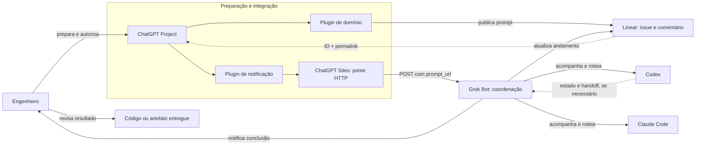
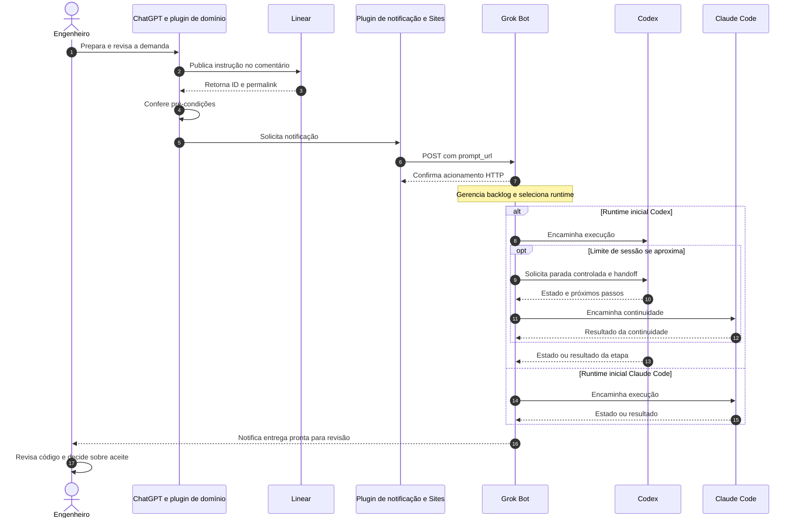

Em um workflow com agentes de programação, uma parte relevante do trabalho acontece antes de qualquer arquivo ser alterado: compreender a demanda, identificar restrições, revisar critérios de aceite e preparar uma instrução que o executor consiga seguir.
Eu vinha tratando parte dessas atividades dentro do mesmo fluxo utilizado para desenvolver no repositório. Mas vale olhar com um pouco mais de calma para o que acontece nessa preparação. Uma coisa é pedir ao agente que encontre a origem de um erro: nesse caso, ele provavelmente vai precisar ler código, consultar logs e testar hipóteses. Outra coisa é discutir se o pedido está claro ou se os critérios de aceite realmente explicam o resultado esperado. Essa segunda conversa pode ser longa, pode exigir bastante raciocínio, mas não necessariamente exige que alguém abra um arquivo do projeto naquele momento. Foi essa diferença que me levou à pergunta: **quanto da preparação de uma tarefa realmente depende de uma sessão de agente de programação?**
Comecei então a experimentar uma separação entre dois momentos. No primeiro, utilizo um ChatGPT Project para interpretar o trabalho e preparar uma instrução estruturada. No segundo, encaminho a referência dessa instrução para o Grok Bot, que coordena a execução em agentes de programação como Codex e Claude Code. Para conectar essas partes, usei plugins do ChatGPT, comentários do Linear, um componente no ChatGPT Sites e um webhook. O objetivo era conseguir iniciar a cadeia a partir de um único comando, sem ficar transportando prompts manualmente entre interfaces.
O resultado não elimina a revisão humana. É um fluxo de **preparação, persistência, acionamento, coordenação entre runtimes e revisão**, com pontos de controle definidos. O mais interessante dessa experiência não foi a requisição HTTP: foi conseguir distribuir responsabilidades que antes exigiam minha intervenção constante entre ferramentas.
## O problema: preparação e execução competindo pelo mesmo fluxo
Quando abrimos um agente de programação, nem toda interação precisa necessariamente de leitura de arquivos, terminal, testes ou alterações no código. Algumas conversas servem primeiro para definir o que deve ser feito.
Isso não significa que essas conversas sejam descartáveis. Pelo contrário. Pense em um pedido como ‘melhore a validação desse formulário’. Melhorar em que sentido? Impedir o envio de dados inválidos, explicar melhor o erro para quem está preenchendo ou mudar as regras que definem o que é válido? Outro exemplo seria pedir para ‘corrigir o login’ sem esclarecer em qual situação ele falha e qual comportamento deveria ocorrer. Nos dois casos, o agente pode fazer uma alteração coerente com uma interpretação do pedido e, ainda assim, entregar algo diferente do que se pretendia. É esse tipo de ambiguidade que a preparação precisa reduzir. Não é uma conversa anterior ao trabalho importante; ela também faz parte do trabalho.
Existe também um custo menos visível: a coordenação manual. Depois de preparar um prompt, eu precisava levá-lo até outro ambiente, escolher o agente, iniciar o trabalho e verificar continuamente se ele havia terminado, falhado ou alcançado algum limite de sessão. Cada transição interrompia o que eu estava fazendo. A automação busca reduzir justamente essas passagens de bastão, não apenas o uso de contexto.
O ponto é outro. **Se a preparação pode ocorrer sem acesso ao ambiente de execução, talvez ela não precise ocupar esse ambiente desde o primeiro momento — nem exigir que eu conduza manualmente cada passo seguinte.**
No meu caso, essa hipótese apareceu enquanto trabalhava com o Axiom, projeto voltado à organização e governança do desenvolvimento assistido por IA. O backlog é acompanhado no Linear, e eu já utilizava o ChatGPT para raciocinar sobre requisitos e tarefas. O Axiom foi o cenário do experimento — não um componente obrigatório da integração.
Havia, porém, uma condição importante: a preparação precisava deixar de ser apenas uma conversa. Não bastava discutir a tarefa, chegar a uma instrução boa e deixar essa instrução perdida no meio das mensagens. Se o próximo passo seria executar o trabalho em outro ambiente, era preciso definir qual conteúdo deveria seguir adiante. Por exemplo: se a conversa passou por três alternativas e a terceira foi a escolhida, o executor não deveria precisar reconstruir toda a discussão para descobrir isso. O resultado dessa preparação precisava ter um endereço, estar associado à tarefa e ser acessível ao fluxo seguinte. É nesse sentido que estou falando de um artefato identificável: não a conversa inteira, mas a instrução que saiu dela.
## A hipótese: especializar cada etapa
A proposta passou a distribuir o trabalho em quatro responsabilidades:
1. **Preparação:** interpretar a demanda, analisar seus artefatos e produzir uma instrução com escopo e critérios de aceite explícitos.
2. **Persistência e referência:** publicar a instrução junto à issue, preservando um identificador que possa ser encaminhado ao próximo componente.
3. **Coordenação e execução:** notificar o Grok Bot, que escolhe o runtime, acompanha o trabalho e pode conduzir a continuidade entre agentes.
4. **Supervisão e aceite:** receber o aviso de conclusão, revisar o resultado e decidir se a entrega atende ao pedido.
A divisão permite que a notificação transporte uma referência à instrução, em vez de carregar todo o prompt. Também permite que o acompanhamento e as trocas de runtime ocorram fora da conversa de preparação.
Mas a solução cria dependências: o executor precisa conseguir acessar o conteúdo correto, os handoffs precisam preservar informações úteis e falhas entre etapas devem ser identificadas. Por isso, não seria adequado apresentá-la como economia automática de custo ou ganho garantido de desempenho.
## Por que comecei pelo ChatGPT Projects
O ChatGPT entrou nesse processo muito antes de existir a integração. O Axiom começou a ser discutido ali, desde a ideação, e continuei utilizando o mesmo Project enquanto o trabalho ganhava especificações, backlog e decisões de arquitetura. Para mim, esse espaço tornou-se um ponto de continuidade: consigo retomar discussões, cruzar artefatos disponíveis, revisar critérios de aceite, analisar backlog e preparar instruções de execução sem começar cada assunto do zero.
Não se trata do ambiente de programação com acesso permanente ao repositório. Estou falando do **Projects na interface convencional de chat**, usado como ambiente de análise e preparação. Dependendo dos documentos e diffs disponíveis, também consigo discutir ou revisar código por ali. Ainda assim, prefiro reservar Codex e Claude Code para as atividades que efetivamente exigem investigação no projeto, alterações em arquivos, testes e execução.
Quando digo que esse uso do ChatGPT é “barato”, refiro-me à minha experiência com os limites dos serviços: realizar uma conversa de preparação no Project não precisa consumir a mesma janela de uso que eu reservaria para um agente de programação. Isso não prova economia financeira nem garante acesso irrestrito a contexto; é uma decisão prática de alocação de ferramentas que precisa ser avaliada dentro de cada plano e workflow.
Também há uma razão histórica: comecei a trabalhar no Axiom com o ChatGPT e só depois fui incorporando outros agentes e ambientes. A arquitetura atual evoluiu a partir desse uso, e não de uma escolha abstrata por uma ferramenta supostamente melhor.
## Por que o Grok Bot não é apenas um webhook
Preparar a tarefa resolve só o começo. Depois, alguém precisa decidir onde executar o trabalho, iniciar a sessão, acompanhar o agente e reagir quando houver interrupção. Eu queria deixar de ser a pessoa responsável por essas transições durante todo o dia.
Na automação que construí, **o Grok Bot acompanha o backlog e o andamento dos cards no Linear** e gerencia o encaminhamento das instruções para runtimes como Codex e Claude Code. Ele não se limita a aceitar o POST inicial: coordena a execução enquanto o trabalho avança, acompanha o estado das sessões e me avisa quando existe uma entrega pronta para revisão.
Um dos comportamentos mais úteis é a continuidade entre runtimes. Quando a janela de uso de um agente está próxima do limite, a rotina pode orientá-lo a interromper a atividade em um ponto controlado e produzir um **handoff**: o que foi feito, o que falta, quais decisões foram tomadas e que contexto é necessário para continuar. O Grok Bot pode então encaminhar a continuidade para outro agente. No meu fluxo, um exemplo é começar pelo Codex e continuar com Claude Code quando a sessão do primeiro se aproxima do limite.
Isso é especialmente valioso quando não estou acompanhando o terminal. Enquanto trabalho em outras atividades — ou mesmo durante a madrugada —, o bot pode prosseguir com o acompanhamento e só me notificar quando há algo a revisar. A revisão do código e o aceite da entrega continuam sob minha responsabilidade; automatizar essas etapas está fora do escopo atual.
**Importante:** descrevo aqui o comportamento da minha automação. As regras de seleção de runtime, identificação do limite de sessão, conteúdo do handoff e autorização de continuidade devem ser documentadas a partir da configuração real; não são uma promessa universal do produto.
## A solução construída
O fluxo utiliza componentes com responsabilidades distintas:
- **ChatGPT Projects (chat convencional):** espaço de análise da demanda, discussão das regras de negócio, organização de contexto e preparação de instruções.
- **Plugin de domínio:** integração configurada para o projeto, responsável pelo processo de geração e validação da instrução, segundo as regras e os artefatos disponíveis.
- **Linear:** referência do backlog e local onde o prompt final é publicado em comentário de uma issue, com ID e permalink próprios.
- **Plugin de notificação:** componente separado do plugin de domínio para expor a ação de acionamento, sem contaminar as regras de preparação com detalhes de infraestrutura.
- **ChatGPT Sites:** componente utilizado nesta implementação como ponte para a comunicação HTTP externa. A ferramenta `notify_cursor` faz parte do fluxo de notificação; o contrato e a localização exatos de cada operação precisam ser conferidos na configuração.
- **Webhook do Grok Bot:** endpoint autenticado que recebe a referência da instrução.
- **Grok Bot:** coordena cards, seleciona runtime, acompanha as sessões e organiza possíveis handoffs e notificações.
- **Codex e Claude Code:** agentes de programação que realizam as tarefas no ambiente de desenvolvimento.
- **Engenheiro:** acompanha a entrega e decide sobre a revisão e o aceite.
### Por que dois plugins e um site intermediário?
A escolha foi uma forma de **separar as regras do projeto dos mecanismos de integração**. O plugin de domínio trata de tarefas de engenharia: gerar o prompt adequado, respeitar o escopo e trabalhar com o contexto do Axiom. O plugin de notificação encapsula a capacidade de solicitar um acionamento externo. O componente hospedado no ChatGPT Sites realiza a ponte HTTP utilizada no meu arranjo.
Desse modo, não preciso incluir URL de webhook, autenticação ou protocolo de notificação na lógica de geração de prompts. Posso alterar a integração externa sem reescrever as regras de negócio do primeiro plugin — e vice-versa, desde que o contrato entre eles permaneça compatível.
Não é correto afirmar que plugins ou o ChatGPT são, por natureza, incapazes de realizar chamadas HTTP. O **uso do Sites como ponte foi uma escolha desta arquitetura**, sujeita às capacidades e permissões concretas das integrações configuradas.
### Visão lógica dos componentes

*Visão lógica inspirada na separação de sistemas e responsabilidades do C4 Model. As setas expressam o comportamento relatado, não endpoints ou permissões confirmados. O caminho pelo ChatGPT Sites e a recuperação efetiva do conteúdo apontado pelo permalink ainda exigem validação do contrato implementado.*
## Como o fluxo funciona
A cadeia pode começar com uma única solicitação no ChatGPT, mesmo que internamente atravesse vários componentes:
1. Escolho uma issue do Linear e discuto no ChatGPT Project seu objetivo, restrições e critérios de aceite.
2. O plugin de domínio prepara a instrução de execução. Eu posso revisá-la antes de seguir.
3. A instrução final é publicada em um comentário do Linear. O fluxo identifica o comentário e obtém seu permalink.
4. As pré-condições de publicação, identificação e etapa são verificadas antes da notificação.
5. A ferramenta `notify_cursor`, por meio da integração de notificação e do ChatGPT Sites, aciona o webhook do Grok Bot com `prompt_url`.
6. O Grok Bot recebe o acionamento e coordena o encaminhamento da tarefa para o runtime selecionado, como Codex ou Claude Code.
7. Enquanto a tarefa está em execução, o bot acompanha o progresso e as condições da sessão.
8. **Se houver necessidade de transição**, o bot pode solicitar um handoff ao agente atual e continuar o trabalho em outro runtime.
9. Quando a execução termina, o bot me notifica. Eu então verifico a entrega e realizo a revisão do código, sem confundir conclusão operacional com aceite funcional.
A mudança prática não é deixar de pensar na tarefa: é **deixar de realizar manualmente cada passagem entre preparação, acionamento, execução e revisão**.
O diagrama dinâmico evidencia tanto a separação entre **disparo e entrega** quanto a possibilidade de continuidade entre agentes:

*Diagrama lógico do comportamento relatado; o handoff é condicional. Não atribui endpoints específicos à leitura do permalink nem comprova a forma de detecção do limite de sessão, a ordenação exata das mensagens ou o mecanismo de notificação. Esses detalhes dependem dos contratos efetivos.*
### O handoff: continuar a tarefa sem reconstruir tudo manualmente
Esse comportamento merece atenção porque o limite de uma sessão não significa, necessariamente, que a tarefa tenha terminado. Em uma operação manual, eu precisaria perceber a aproximação do limite, pedir um resumo ao agente, abrir outra sessão e explicar novamente o que já foi feito.
No meu fluxo, o Grok Bot consegue coordenar essa passagem. Antes da troca, orienta o agente a produzir um handoff sobre o estado do trabalho. O agente seguinte recebe informações para continuar a partir do ponto em que o anterior parou, em vez de tratar a demanda como se estivesse começando do zero.
O exemplo mais concreto do uso que descrevo é uma execução iniciada no Codex que precisa continuar no Claude Code porque a janela de utilização do primeiro está se esgotando. Isso não garante que qualquer handoff seja perfeito: decisões, alterações pendentes, testes e restrições precisam ser registrados e verificados. A qualidade do conteúdo transferido é parte do problema de engenharia.
**Ainda precisamos anexar ao estudo de caso uma execução real dessa transição**, com os artefatos sanitizados, para demonstrar como o fluxo de continuidade foi realizado.
### Por que publicar a instrução no Linear?
A decisão de usar o comentário como ponto de passagem permite associar a instrução a uma issue concreta. O webhook recebe uma URL, e não um texto longo que precisaria atravessar toda a cadeia de acionamento.
Há uma diferença importante entre **persistir uma instrução** e **garantir sua imutabilidade**. Publicar o texto resolve uma questão: a instrução deixa de existir apenas na conversa e passa a ter uma referência. Mas isso não resolve, sozinho, outra questão: qual versão do texto será lida depois? Imagine que eu revise o comentário, confira o permalink e só então faça o acionamento. Se o conteúdo puder ser alterado antes de o executor consultá-lo, o endereço pode continuar sendo o mesmo, embora a instrução já seja outra. O link identifica onde o conteúdo está; ele não comprova, por si só, que o conteúdo permaneceu igual. Por isso, persistir e garantir a versão utilizada são problemas relacionados, mas não são o mesmo problema.
Nesta versão do experimento, a persistência do comentário e o uso de seu permalink estão documentados. A política de versionamento, alteração e consumo da instrução pelo bot ainda precisa ser descrita com base na execução real.
### O contrato HTTP: pequeno por escolha
O corpo da requisição documentado é:
```json
{
  "prompt_url": "<permalink-real-do-comentario>"
}
```
O webhook utiliza uma chave enviada por Bearer Auth. Para ilustrar a chamada, sem expor URL nem credenciais, o acionamento pode ser representado por:
```bash
curl --request POST "$GROK_WEBHOOK_URL" \
  --header "Authorization: Bearer $GROK_WEBHOOK_KEY" \
  --header "Content-Type: application/json" \
  --data "{\"prompt_url\":\"$LINEAR_COMMENT_PERMALINK\"}"
```
O comando é **ilustrativo**: pressupõe que as variáveis foram configuradas e não representa, por si só, toda a validação realizada pela ferramenta `notify_cursor`. Também não deve ser executado com uma URL ou chave real divulgada em uma publicação.
A documentação do Cursor é explícita sobre a semântica desse endpoint: **HTTP 200 informa que o Grok Bot aceitou a chamada e iniciou uma execução; não significa que a rotina terminou ou que o trabalho foi aprovado.** O resultado precisa ser acompanhado no histórico do bot.
Vale separar esses momentos porque eles respondem a perguntas diferentes. A instrução foi publicada? Isso confirma que o conteúdo foi registrado, não que uma execução começou. O acionamento foi aceito? Isso informa sobre o início da rotina, não sobre sua conclusão. E mesmo quando a rotina termina, ainda falta olhar para a entrega. Por exemplo: o agente pode concluir uma alteração, mas deixar de atender a um dos critérios de aceite da issue. Ou pode resolver o caso principal e não contemplar uma condição que também fazia parte do pedido. Nesses exemplos, terminar a rotina e concluir satisfatoriamente a tarefa são coisas diferentes. Por isso, além da publicação, do acionamento e da conclusão, existe uma quarta pergunta: o resultado realmente atende ao que foi solicitado?
## O que foi observado — e o que ainda não foi medido
A experiência trouxe ganhos operacionais que consigo identificar no uso cotidiano. O primeiro é a **redução das transições manuais**: preparo a tarefa em um lugar, o prompt é publicado no Linear e a notificação segue para o executor sem que eu precise copiar e colar instruções entre interfaces.
O segundo é a **distribuição das responsabilidades**. Deixo as conversas de preparação, análise de backlog e parte das revisões no ChatGPT Project; utilizo os agentes de código quando preciso das suas capacidades de execução. O terceiro é a **continuidade operacional**: o Grok Bot acompanha a tarefa, pode coordenar um handoff entre Codex e Claude Code quando a sessão exige uma troca e avisa quando há uma entrega para minha revisão.
Na prática, isso permite que o trabalho prossiga mesmo quando estou ocupado com outras atividades, inclusive à noite. Percebo menos necessidade de atuar como intermediário entre ferramentas. Esses são **relatos de uso**, não resultados de um experimento controlado.
Já foi possível operar o fluxo descrito; no entanto, este artigo ainda não traz uma cadeia pública de evidências conectando uma issue, o prompt preparado, uma execução e o artefato final validado. Também falta anexar o exemplo concreto do handoff entre runtimes. Sem isso, a narrativa explica o comportamento observado, mas ainda não permite que o leitor o audite integralmente.
Não tenho medições controladas de:
- redução de tokens ou consumo de sessões;
- economia financeira;
- tempo de preparação ou execução;
- quantidade de intervenções manuais antes e depois;
- qualidade das entregas ou taxa de retrabalho.
Assim, **redução de custo e aumento de produtividade permanecem hipóteses**, não conclusões. Se eu deixar de usar parte de uma sessão do agente de programação, mas passar esse mesmo tempo preparando a tarefa em outro serviço, houve uma mudança na distribuição do trabalho. Isso, sozinho, ainda não demonstra economia. Também pode acontecer de uma instrução mais trabalhada reduzir as intervenções durante a execução, mas exigir mais tempo antes dela. Nesse caso, eu precisaria olhar para o processo inteiro, e não apenas para a etapa que pareceu ficar mais rápida. São possibilidades que ajudam a explicar o que falta medir: onde o consumo diminuiu, onde aumentou e se a diferença trouxe um resultado melhor.
A validação mais útil será comparar tarefas de complexidade semelhante no fluxo anterior e no novo, acompanhando tempo, intervenções, tentativas, qualidade do resultado e consumo de cada produto.
## Onde a abordagem exige mais cuidado
A separação de responsabilidades melhora a legibilidade do processo, mas introduz novos pontos de falha.
**Conteúdo da instrução.** A URL pode continuar válida mesmo se o texto do comentário mudar. Sem uma política de versão ou verificação no momento do uso, não devemos afirmar que a execução recebeu exatamente o conteúdo validado anteriormente.
**Permissões.** A capacidade de publicar comentários não é a mesma capacidade de consultar a issue ou modificar um repositório. Cada integração deve possuir as permissões necessárias à sua responsabilidade, sem confundir dados recebidos com autorizações para agir.
**Instruções não confiáveis.** Uma issue pode conter informação incorreta, contraditória ou maliciosa. O conteúdo analisado e encaminhado entre agentes deve ser tratado como dado de entrada, sujeito às políticas e aos limites do executor.
**Falhas e duplicidades.** Um timeout não comprova que o POST deixou de chegar ao serviço. Repetir uma chamada pode produzir uma nova execução caso o destino não implemente deduplicação. Idempotência precisa ser garantida por um contrato ou mecanismo real; não basta enviar um identificador sem suporte do destinatário.
**Resultado.** Uma rotina pode ser iniciada e ainda assim falhar; pode também terminar sem entregar um resultado aceitável. Acompanhamento operacional e validação humana são responsabilidades distintas.
**Continuidade entre runtimes.** Um handoff pode preservar contexto e evitar recomeçar uma tarefa, mas também pode transferir premissas erradas, ignorar alterações não persistidas ou deixar a validação incompleta. O novo agente precisa verificar o estado efetivo do repositório e os critérios de aceite, não apenas confiar no resumo recebido.
**Limites de sessão.** O momento de solicitar handoff depende dos sinais de uso disponíveis e da lógica de acompanhamento adotada. Não devemos tratar uma janela de cinco horas, sua detecção ou sua troca automática como garantias universais dos agentes.
Esses são riscos e decisões a documentar, não funcionalidades que estou atribuindo à implementação sem evidência.
## Por que não executar tudo diretamente no agente de código?
A alternativa mais simples seria preparar a demanda e executar a alteração na mesma sessão do agente de programação. Ela reduz a quantidade de componentes e evita parte dos problemas introduzidos por comentários, links e webhooks.
Também seria possível explorar eventos nativos da plataforma de execução ou enviar o próprio prompt no payload, caso a integração utilizada suportasse esse contrato.
Escolhi investigar a preparação fora do executor porque queria experimentar a separação entre **formular o trabalho** e **realizá-lo**. O Linear passou a ocupar o papel de referência compartilhada entre esses momentos.
Também não quis transformar o Grok Bot em meu ambiente principal de análise: ele já tem uma responsabilidade operacional relevante — acompanhar backlog, sessões, roteamento e entregas enquanto eu faço outras atividades. Deixar a preparação no Project e o acompanhamento no bot é uma divisão deliberada; não significa que nenhuma das ferramentas pudesse, tecnicamente, executar parte das responsabilidades da outra.
O custo dessa escolha é uma cadeia maior de dependências. Essa troca pode valer a pena quando a instrução precisa ser revisada, persistida e reaproveitada; pode não valer quando a tarefa é pequena, depende intensamente do código existente ou exige investigação imediata do ambiente de execução.
Nem todo planejamento pode ser feito adequadamente fora do repositório. Se a tarefa é refatorar uma parte do sistema, por exemplo, eu posso precisar entender primeiro quem depende dela, quais comportamentos os testes protegem e quais restrições a implementação atual impõe. Se o trabalho é investigar um erro intermitente, pode ser que nem o problema esteja suficientemente definido antes de consultar logs e testar algumas hipóteses. Nesses casos, preparar e executar não são duas etapas tão separadas: a investigação no ambiente de execução ajuda a descobrir o que precisa ser feito. Por isso, não estou propondo retirar todo o planejamento do agente de código. Estou tentando distinguir o que já pode ser preparado fora dele daquilo que só fica claro quando entramos no projeto.
## O principal aprendizado
O que mudou minha percepção não foi descobrir que o ChatGPT consegue participar de uma integração HTTP. Foi perceber que eu poderia **dar responsabilidades diferentes a ferramentas diferentes e reduzir a necessidade de coordená-las manualmente**.
O ChatGPT Project é onde organizo o contexto e preparo o trabalho. O plugin de domínio traduz essa preparação em uma instrução operacional; o Linear preserva a instrução associada à tarefa. Um segundo plugin e o ChatGPT Sites viabilizam a notificação externa, mantendo os detalhes da integração fora das regras do projeto. O Grok Bot recebe essa referência e assume o acompanhamento da execução, incluindo o roteamento entre Codex e Claude Code e os handoffs condicionais.
A parte que considero mais valiosa acontece quando não preciso estar presente para cada transição: o bot continua acompanhando a atividade e me chama quando existe algo a revisar. Isso **não elimina o engenheiro do processo**. Ainda sou responsável por avaliar alterações, tratar ambiguidades, decidir sobre o resultado e autorizar o que será aceito.
Existem limites reais: o contexto pode ficar desatualizado, o handoff pode perder informação, as permissões precisam ser bem delimitadas e os custos ainda devem ser medidos. Não estou propondo um modelo universal de desenvolvimento, mas relatando a evolução de um workflow que hoje me permite trabalhar de forma mais assíncrona.
**O aprendizado é que preparar, encaminhar, executar e revisar não precisam acontecer no mesmo ambiente nem ser conduzidos manualmente pela mesma pessoa em cada etapa.** A arquitetura permite experimentar essa divisão; a qualidade das entregas e os ganhos quantitativos ainda precisam ser demonstrados com evidências.
## Referências técnicas
- [Cursor — Grok Bot Routines](https://cursor.com/help/grok-bot/routines): configuração de webhook, Bearer Auth e distinção entre acionamento e conclusão.
- [Cursor — Automations](https://cursor.com/docs/cloud-agent/automations): mecanismos alternativos de automação e gatilhos.
- [OpenAI — Creating custom MCP apps in ChatGPT](https://help.openai.com/en/articles/12584461-creating-custom-mcp-apps-in-chatgpt): capacidades e requisitos de integrações MCP personalizadas.
- [OpenAI — Connecting custom MCP servers in ChatGPT](https://help.openai.com/en/articles/12584461-connecting-custom-mcp-servers-in-chatgpt): distinções atuais entre conexões, ferramentas e apps MCP.
- [C4 Model — Dynamic diagrams](https://c4model.com/diagrams/dynamic): referência para representar interações entre componentes.
- [Axiom — página de contexto](https://app.notion.com/p/3b4e01f22626810791b4f9d016ab5979) — contexto do projeto utilizado no experimento.
